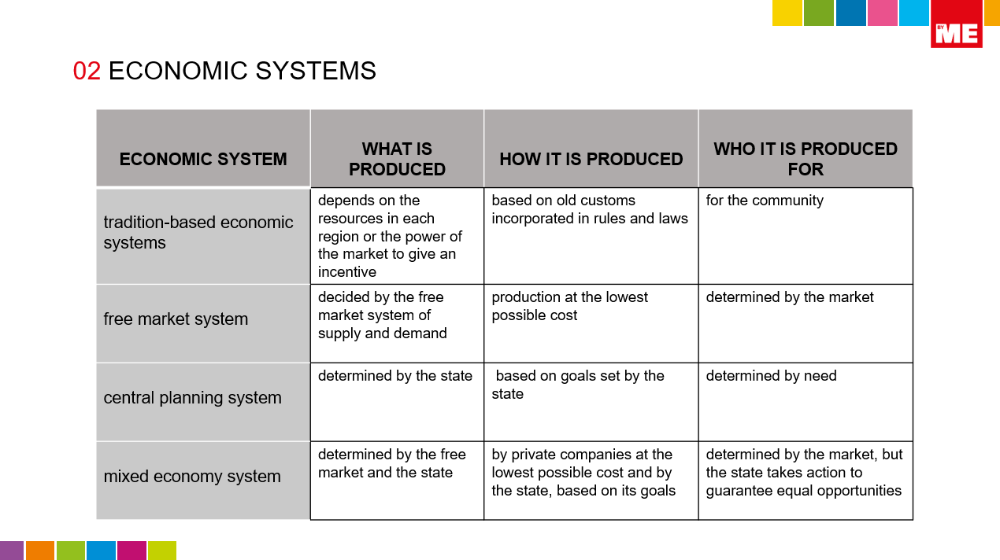
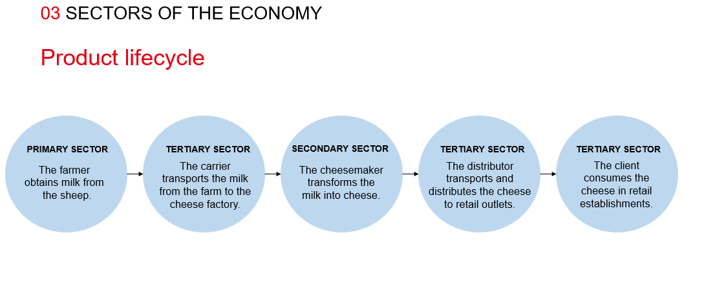

**ECONOMIC ACTIVITY**

1. **Human needs and production**

**Introduction**

- **Economic activity meet human material needs through the production of goods and services.**

**Three groups:**

1. **Production: consists of the creation of goods and services, such as food producer by a farmer.**
2. **Distribution: involves transportating goods from the producer to the consumer, such as the transportation of food from farms to shops.**
3. **Consumption: is based on using the goods and services produced.**

**1.1 Economic agents**

1. **Households: use the goods and services offered by businesses and the government, supply labour to businesses and government in exchange for wages.**
2. **Businesses: employ labour to produce goods and services.**
3. **Government: produces and uses goods and services, such as healthcare, schools... The government collects taxes from households and businesses to pay for these services.**

- 1.2. **Factors of production**

- Factors of production are the resources involved in producing goods and services.

1. **Natural resources: raw materials found in nature.**

**Renewable** resources can be consumed **without being exhausted**, because they regenerate faster  than they are consumed **(water, wind…).**

**Non-renewable** resources **regenerate more slowly** than they are consumed. They can run out if we overconsume them **(oli, coal, iron ore..).**

2. **Capital:  is divided in three groups:**

**Human capital** the **labour** that workers contribute.

**Physical capital raw materials, tools, machinery…**etc.

**Financial capital the money needed** to pay for physical capital and human capital.

3. **Labour: the role of labour is to produce goods or provide services to receive financial compensation. A wage or salary is the payment which employees receive for their labour.**

**Purchasing power:** refers to how many goods/services a person can buy with their wage. If wages rise but prices rise faster, purchasing power falls.

2. **Economic systems**

**2.1 Tradition-based economic system**

In the past , people developed economic systems based on beliefs, customs and laws.

**In present-day, tradition-based societies experienced little change. Despite the power of globalization, there are groups of people in the Arctic Circle, the Amazon, Africa, Shouteast Asia and Oceania whose economic activities are still based on tradition.**

Tradition-based system only allow for very **limited economic growth**.

Production is restricted to **self-consumption and subsitence**. The households essentially follow this two principles:

- They purchase **very few goods and consume only what they produce**.
- They generate very little suplus, their production is limited to achieving **self-sufficiency**.

**2.2 Capitalism and the free market system**

Capitalism is characterized by the following factors:

- **Private ownernship** of the **means of production**, which includes physical and financial capital.
- **Investment of capital**
- **Free market**

The free market regulates the production and sale of products and services based on the prices established by supply and demand.

- **Price**: the value assigned to a product or service.
- **Supply**: the products available on the market.
- **Demand**: the products or services that consumers want to buy for.

According to this:

- **Prices decrease**. If the supply is high but the demand is low, it creates a **surplus**.
- **Prices increase**: If the demand is high but the supply is low, there is a **shortage** of products.

**2.3 Authority: the central planning system**

In the central planning system, the **state make the decisions**. This system was most developed in **communist countries** (Soviet Union, China…).

The ultimate aim is to achieve greater **social equality** and prevent the injustices caused by the unequal distribution of wealth. **The state** determines which goods or services they should produce, how to produce them and who to produce them for. However, this system **is not always efficient**. The state´s predictions can turn out to be wrong.

Example: **North Korea, China, Cuba…..**

**2.4 The mixed economy system**

Most countries have a mixed economy system (**France, UK, Spain**…). The aim of this system is to avoid both the negative effects of the unequal distribution of wealth in a free market system and the lack of efficiency that characterizes authority-based systems.

The free market deals with basic economic problems, but the state act to help guarantee equal opportunities. To do so, it collects **taxes**. This money is used to finance what is known as the welfare state (public goods and services).

3. **Sectors of the economy**

**3.1The primary sector**

**The primary sector consists of activities related to obtaining natural resources.**

1. **Agriculture: farming the land to to produce raw materials (cereals, fruit…).**
2. **Livestock farming: Raising animals for food and for raw materials (leather, wood…).**
3. **Forestry: Harvesting the wood from trees in forests.**
4. **Fishing: involves catching or farming fish, molluscs and crustaceans.**

- 3.1. **The secondary sector**

**The secondary sector transforms raw materials into capital goods.**

1. **Mining: consists of removing rocks and minerals from subsoil. Although this activity involves obtaining raw materials, it usually classified as part of the secondary sector.**
2. **Industrial activities: transform raw materials into goods.**
3. **Construction of buildings (homes, factories, offices,etc.).**
4. **Energy production consists of extracting energy from natural resources.**

- 3.2. **The tertiary sector**

The tertiary sector or service sector **includes all the activities that produce service**s. It is divided into a large number of subsectors, include the following:

1. **Commerce: involves distributing and selling the products.**
2. **Transportation and communications: relate to the movement of people and goods.**
3. **Tourism: relates to the temporary movement of people from one place to another.**
4. **Services: healthcare, education, legal services…**
5. **Banks and financial services: services related to saving and moving money.**

